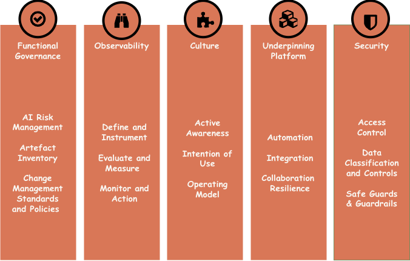
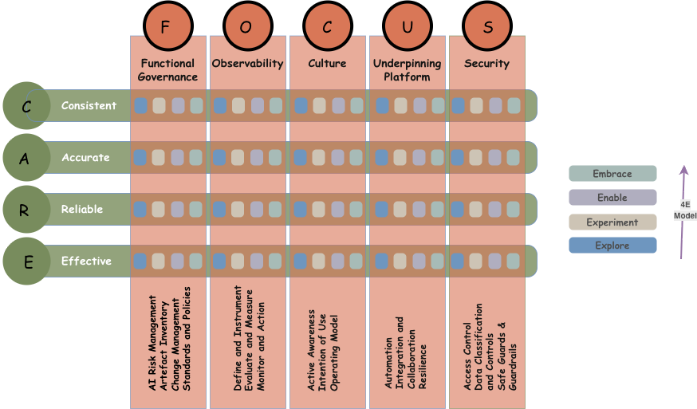

---
hide:
  - navigation
---
# FOCUS — The Five Institutional Pillars

FOCUS defines the five vertical pillars through which maturity is assessed across all four 4E stages. These pillars are not sequential priorities — they are parallel dimensions that every organisation must develop simultaneously, at different rates depending on context and risk exposure.

<figure markdown="span">
  { width=600 }
  <figcaption></figcaption>
</figure>

> **Functional Governance (F)** covers the policies, standards, risk management structures, accountability mechanisms, and artefact inventory practices that make AI adoption safe, compliant, and auditable. The emphasis on "Functional" is deliberate — governance that exists on paper but doesn't influence engineering decisions is not governance. At mature stages, Functional Governance means actively integrated guardrails that facilitate work rather than blocking it, with risk controls embedded into delivery pipelines rather than bolted on after the fact.

---

> **Observability (O)** covers the telemetry, instrumentation, monitoring, logging, and feedback loops that give organisations visibility into how their AI systems are actually behaving in production. This includes not just performance metrics but bias detection, drift monitoring, safety signal tracking, and the audit trails needed for accountability. At mature stages, Observability means that operational and optimisation decisions are triggered automatically by live monitoring data — the organisation is not waiting for problems to be reported, it is detecting them before users notice.

---

> **Culture (C)** covers the shared values, psychological safety, AI literacy, operating norms, and awareness practices that determine whether people in the organisation engage with AI thoughtfully and responsibly. Culture is the hardest FOCUS area to score because it is the most diffuse — but it is also the most consequential. An organisation with world-class platform infrastructure and a culture that treats governance as someone else's problem will fail at scale. At mature stages, Culture means AI-aware norms are self-sustaining: people proactively identify and surface risks, disclose AI involvement in their work, and hold each other to responsible practice standards without needing to be told.

---

> **Unified Platform (U)** covers the foundational technology stack — compute infrastructure, data pipelines, model registries, MLOps and DataOps tooling, integration patterns, automation capabilities, and resilience architecture. The word "Unified" is significant: the Platform pillar is not about individual tools but about the coherent, shared capability that makes AI delivery repeatable and scalable across the organisation. At mature stages, the Unified Platform is fully integrated into core engineering systems, supports agentic workloads with appropriate isolation, and self-optimises cost, performance, and resilience.

---

> **Security (S)** covers the defence-in-depth strategy protecting AI systems from data exposure, identity risks, adversarial attacks, prompt injection, model-specific vulnerabilities, and the unique attack surfaces introduced by LLMs and agentic systems. AI security is not a subset of general information security — it requires its own threat models, its own controls, and its own testing disciplines. At mature stages, security posture is continuously validated through automated testing, threat detection is integrated into AI operations, and controls adapt proactively as the threat landscape evolves.

---

## How FOCUS areas contribute to Maturity Model?

The model is built on two interlocking structures: the 4E Maturity Spine, which defines four progressive stages of organisational AI adoption, and FOCUS, which defines five vertical pillars through which maturity is assessed and developed. Together they form a 20-cell scoring matrix — the primary output surface of the Trustably Playbook assessment.

<figure markdown="span">
  { width=950 }
  <figcaption></figcaption>
</figure>

The model is directly grounded in three leading AI governance frameworks: NIST AI Risk Management Framework (AI RMF), Databricks AI Security Framework (DASF), and AWS Well-Architected AI Lens. Every suggested action, rubric descriptor, and scoring question in the Institutional Maturity Model traces back to one or more of these sources, giving organisations both a practical assessment tool and a compliance mapping they can use with regulators, auditors, and boards.

 