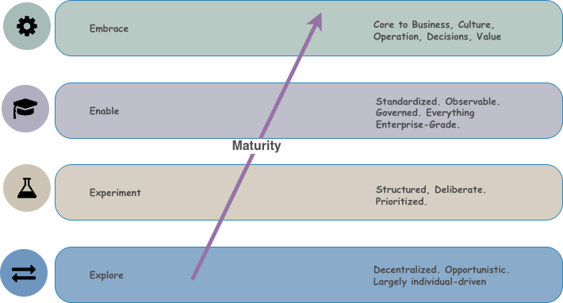

---
hide:
  - navigation
---
# Maturity Model

---

## What is the Institutional Maturity Model?

The Institutional Maturity Model is the organisational dimension of Trustably. It describes how organisations progress in their AI adoption journey - across five distinct capability areas and 6 distinct individual habits, each of which can be at a different maturity level at any given time.

---

## The 4E Maturity Spine 

The four stages of the 4E model describe qualitatively different states of AI adoption — not just "more" of the same capability, but fundamentally different operating modes. Each stage has a distinct character, a distinct risk profile, and a distinct set of organisational priorities.

<figure markdown="span">
  { width=600 }
  <figcaption></figcaption>
</figure>

> **Explore** is the beginning. AI adoption is decentralised, opportunistic, and largely individual-driven. Teams are experimenting with AI tools on their own initiative, with limited central oversight and no shared infrastructure or governance. The dominant risk at this stage is not that AI will fail — it is that AI will succeed quietly, embedding itself into workflows before anyone has assessed the implications. Explore organisations often don't know what AI is already being used across their teams, and the gap between what people are doing and what is officially sanctioned is wide.

---

> **Experiment** introduces structure. The organisation has identified priority use cases and is running deliberate, risk-mapped pilots in controlled environments. There is a growing awareness of governance requirements, and initial policies and accountability structures are being drafted. The dominant risk at this stage is that pilots succeed in isolation but fail to generalise — the organisation learns from its experiments but doesn't build the foundations needed to scale them. Experiment organisations often have strong pockets of AI capability and weak enterprise readiness.

---

> **Enable** is the platform stage — the hardest transition and the one where most organisations stall. At Enable, AI moves from project to platform: standardised infrastructure, model registries, MLOps pipelines, centralised governance, and enterprise-wide guardrails replace the ad-hoc tooling of earlier stages. The dominant risk at Enable is the operational complexity of standardisation — the organisation is simultaneously trying to scale what works, retire what doesn't, and govern everything in between. Enable requires the most deliberate investment of any stage because the decisions made here define the architecture the organisation will operate on for years.

---

> **Embrace** is the destination. AI is no longer a technology initiative — it is a core, self-governing business utility woven into how the organisation operates, makes decisions, and creates value. Governance at Embrace is proactive rather than reactive, platforms are self-optimising, and the culture has internalised responsible AI practice as a professional standard rather than a compliance requirement. The dominant risk at Embrace is complacency — organisations at this stage face the temptation to stop investing in governance because things appear to be working.

 